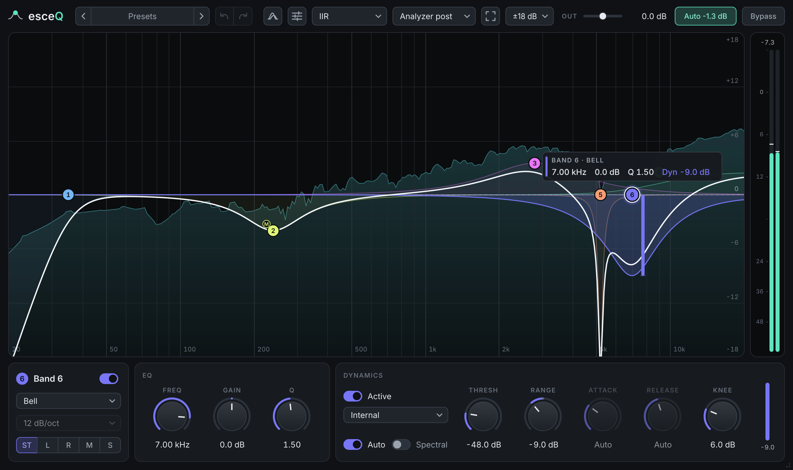

# esceQ

Ecualizador paramétrico y dinámico, libre, pensado para funcionar bien en FL Studio y en cualquier host VST3.

Ecualizador de 24 bandas con curva interactiva, analizador de espectro, dinámica por banda con sidechain externo, procesado por banda en estéreo, L, R, Mid o Side, deshacer y rehacer, y presets. Formatos VST3, CLAP y AU. La hoja de ruta está en [PLAN.md](PLAN.md) y los cambios de cada versión en [CHANGELOG.md](CHANGELOG.md).



## Instalar

Descarga la última versión en [Releases](https://github.com/guillesanper/plugin/releases).

| Sistema | Archivo | Cómo |
|---|---|---|
| Windows (x64) | `esceQ-X.Y.Z-windows-x64-setup.exe` | Ejecuta el instalador: deja el VST3 en `C:\Program Files\Common Files\VST3` y el CLAP en `C:\Program Files\Common Files\CLAP`. Como no está firmado, Windows SmartScreen avisa: "Más información" → "Ejecutar de todas formas". En FL Studio: *Options → Manage plugins → Find installed plugins* |
| macOS (Apple Silicon e Intel) | `esceQ-X.Y.Z-macos-universal.zip` | Copia `esceQ.vst3`, `esceQ.component` y `esceQ.clap` a las carpetas de `~/Library/Audio/Plug-Ins/`. No están firmados con un certificado de Apple: `INSTALL.txt` explica cómo permitir su carga |
| Linux (x64) | `esceQ-X.Y.Z-linux-x64.tar.gz` | Copia `esceQ.vst3` a `~/.vst3/` y `esceQ.clap` a `~/.clap/` |

FL Studio carga el VST3 por defecto; el CLAP también funciona (FL Studio 2024.1 o posterior).

## Uso

| Acción | Cómo |
|---|---|
| Añadir una banda | Doble clic en un hueco de la curva |
| Mover frecuencia y ganancia | Arrastrar el nodo (con Mayús, ajuste fino) |
| Cambiar el Q | Rueda del ratón sobre el nodo o con la banda seleccionada |
| Cambiar el tipo de filtro | Clic derecho en el nodo, o el panel inferior |
| Eliminar una banda | Doble clic en el nodo |
| Hacer dinámica una banda | Botón "Dynamic" del panel inferior, o clic derecho en el nodo |
| Elegir el canal de una banda | Selector ST / L / R / M / S del panel inferior, o clic derecho en el nodo |
| Ajustar un potenciómetro | Arrastrar; Mayús para ajuste fino; rueda; doble clic o Ctrl/Cmd + clic para el valor por defecto |
| Escribir un valor | Clic en el número bajo el potenciómetro ("1.2k", "-3", "350 Hz") |
| Deshacer y rehacer | Flechas de la barra superior, o Ctrl/Cmd+Z y Ctrl/Cmd+Mayús+Z. Un arrastre es una sola acción |
| Cargar o guardar un preset | Nombre del preset en la barra superior; las flechas de los lados pasan al anterior o al siguiente |
| Cambiar el tamaño de la ventana | Botones S, M, L de la barra superior, o arrastrar la esquina |
| Teclado | Tabulador recorre los controles; flechas para cambiar el valor; en la curva, izquierda y derecha eligen banda |

Tipos: campana, shelf de graves y de agudos, corte de graves y de agudos (6 a 96 dB/oct), notch, paso banda, paso todo y tilt. Todo es automatizable desde el host.

**Dinámica:** las campanas, los shelves y el tilt pueden ser dinámicos. Cuando el nivel en su zona del espectro supera el umbral, la banda baja (rango negativo: de-esser, control de resonancias) o sube (rango positivo) hasta el rango indicado, con ataque, relajación y rodilla ajustables. La curva muestra en tiempo real la ganancia que se está aplicando, con la estática punteada como referencia. El detector escucha la entrada del plugin o, con "External", el sidechain.

**Canal:** cada banda actúa en estéreo, solo en el canal izquierdo o el derecho, o solo en Mid (lo que está en el centro) o Side (lo que está a los lados). Lo que la banda no toca pasa intacto. Una banda dinámica escucha ese mismo canal. El nodo de una banda que no es estéreo lleva su letra (L, R, M, S).

**Presets:** vienen cinco de fábrica (De-esser, Resonance Control, Low-End Cleanup, Vocal y Gentle Master) como punto de partida. Los tuyos se guardan con "Save as..." como archivos `.esceq` en `%APPDATA%\esceQ\Presets` (Windows), `~/Library/Application Support/esceQ/Presets` (macOS) o `~/.config/esceQ/Presets` (Linux); "Open presets folder" abre esa carpeta. Un punto junto al nombre indica que has modificado el preset. El analizador, el rango y el tamaño de la ventana se guardan con el proyecto, no con el preset.

**Sidechain en FL Studio** (pasos aún sin verificar en FL Studio): en el mezclador, haz clic derecho en la flecha de envío de la pista que debe controlar el EQ y elige "Sidechain to this track" en la pista donde está esceQ. Luego, en los ajustes del envoltorio del plugin (rueda dentada, pestaña *Processing*), asigna esa entrada al puerto de sidechain. Si eliges "External" sin nada conectado, el panel lo avisa con "No sidechain".

## Compilar

```
cmake -S . -B build -DCMAKE_BUILD_TYPE=Release
cmake --build build --config Release --parallel
```

Detalles, requisitos y reglas de contribución en [CONTRIBUTING.md](CONTRIBUTING.md).

## Documentación

- [DEV.md](DEV.md): cómo montar el entorno de desarrollo, paso a paso.
- [PLAN.md](PLAN.md): objetivos, decisiones y hoja de ruta.
- [docs/arquitectura.md](docs/arquitectura.md): módulos, contratos y modelo de hilos.
- [docs/ui.md](docs/ui.md): sistema visual, controles y accesibilidad.
- [docs/dsp/filtros.md](docs/dsp/filtros.md): cómo están hechos los filtros.
- [docs/dsp/ecualizador.md](docs/dsp/ecualizador.md): suavizado, fundidos y analizador.
- [docs/decisiones/0009-preferencias-deshacer-y-presets.md](docs/decisiones/0009-preferencias-deshacer-y-presets.md): estado guardado, deshacer y presets.
- [docs/dsp/dinamica.md](docs/dsp/dinamica.md): detector, envolvente y curva de ganancia de las bandas dinámicas.
- [docs/decisiones/](docs/decisiones/README.md): registro de decisiones de diseño.
- [CHANGELOG.md](CHANGELOG.md): cambios por versión.

## Licencia

El plugin se distribuye bajo [AGPL-3.0-or-later](LICENSE). La biblioteca de `dsp/` se distribuye bajo [MIT](dsp/LICENSE). La interfaz incluye la tipografía [Inter](https://rsms.me/inter/), bajo [SIL Open Font License 1.1](ui/assets/fonts/OFL.txt).
