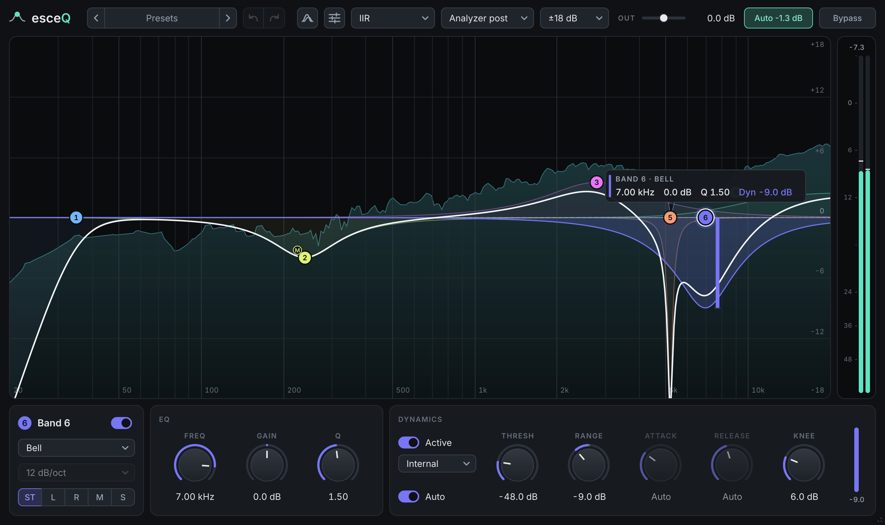
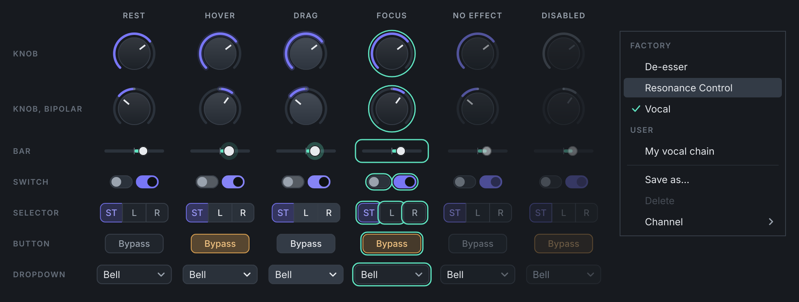
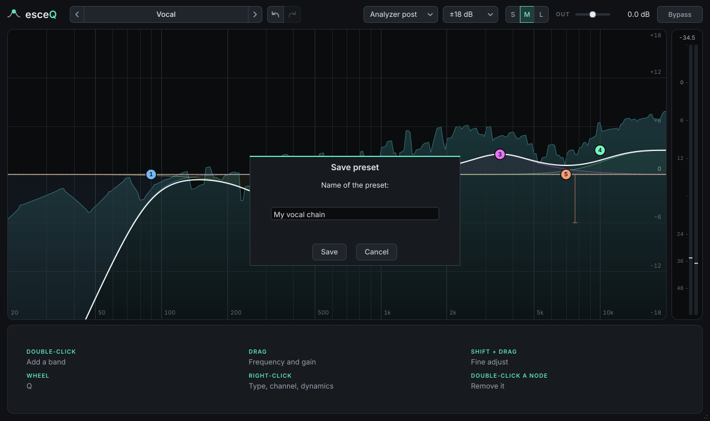
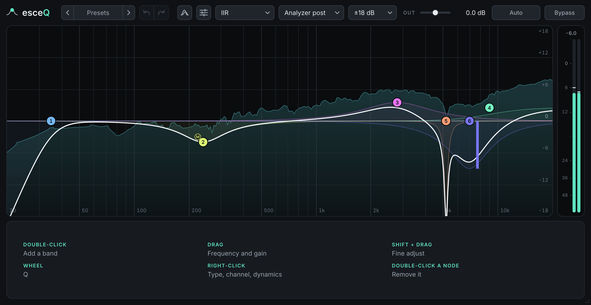
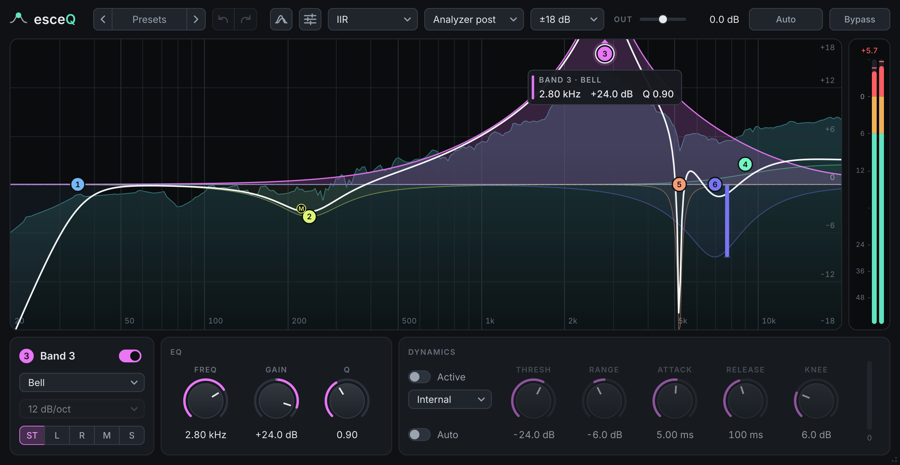
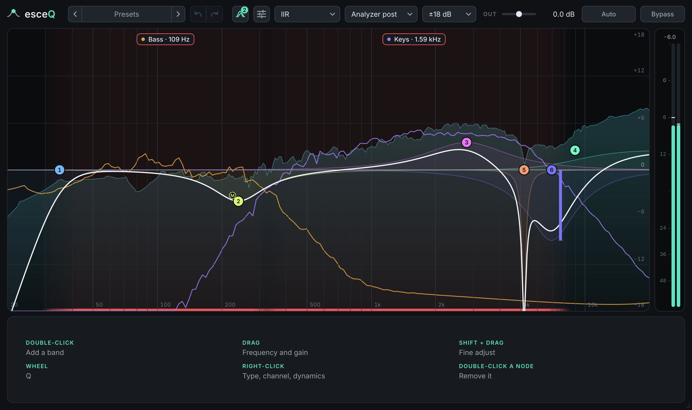
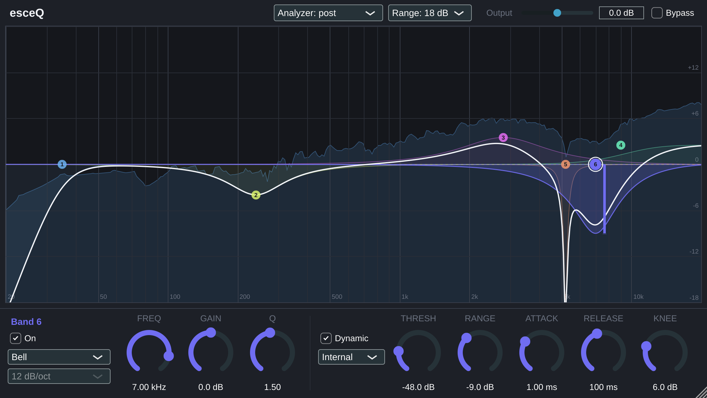

# Interfaz

Cómo está hecha la interfaz de esceQ y qué reglas sigue. Las decisiones y sus motivos están en la [ADR 0008](decisiones/0008-sistema-visual.md); la estructura de módulos, en [arquitectura.md](arquitectura.md).



## Capas

| Capa | Dónde | Qué hace | Tests |
|---|---|---|---|
| Lógica | `ui/logic/` (C++20 puro, sin JUCE) | De gestos a valores, escalas, disposición de la ventana, geometría de la curva | `tests/ui/` |
| Tema | `ui/src/Theme.h` | Colores, tipografía, espaciado, radios y grosores | — |
| Dibujo | `ui/src/Draw.h` | Funciones sin estado que pintan cada pieza en un estado dado | Galería de capturas |
| Componentes | `ui/src/Controls.h`, `BandPanel`, `CurveView`, `OutputMeter`, `EqEditor` | Reciben el ratón y el teclado, deciden el estado, llaman a la lógica y al dibujo | Capturas y `pluginval` |
| Aspecto de JUCE | `ui/src/EsceqLookAndFeel.h` | Viste desplegables, menús, campos de texto y botones de texto | Capturas |

Regla: **si algo se puede calcular sin ventana, va en `ui/logic` con su test.** `ui/src` solo pinta y traduce gestos.

## Sistema de diseño

Todo sale de `ui/src/Theme.h`. Ningún componente escribe un color o una medida de estilo a mano.

### Color

| Token | Valor | Uso |
|---|---|---|
| `window` | `#0F1114` | Fondo de la ventana |
| `plot` | `#0A0C0E` | Fondo de la curva y de los medidores |
| `card` | `#171A1F` | Tarjetas del panel, menús, etiqueta flotante |
| `control` / `controlHover` / `controlDown` | `#20252C` / `#2A313A` / `#333B46` | Cuerpo de los controles: reposo, ratón encima, pulsado |
| `track` | `#2B323B` | Recorrido vacío de arcos, barras e interruptores |
| `line` / `lineStrong` | `#262B32` / `#373E48` | Bordes y rejilla |
| `text` / `textMuted` / `textDim` | `#E7EAEE` / `#9AA3AE` / `#67707C` | Valores, texto secundario, etiquetas y escalas |
| `accent` | `#5FE3C0` | Color propio de esceQ: controles globales, foco de teclado, marca |
| `curve` | `#F3F5F8` | Curva total |
| `analyzerPost` / `analyzerPre` | `#3F8F96` / `#7B8592` | Analizador |
| `warning` / `danger` | `#F0B057` / `#FF5D62` | Bypass y avisos; recorte |

Cada banda tiene su color (`theme::band(i)`: tonos repartidos por la proporción áurea) y **tiñe sus propios controles**: el nodo, su curva, y los potenciómetros e interruptores del panel. Lo global (salida, tamaño de ventana, foco) usa el acento.

### Tipografía

Inter (SIL OFL 1.1), embebida en el binario: Regular, Medium y SemiBold. Los archivos y su licencia están en `ui/assets/fonts/`.

| Token | Tamaño | Uso |
|---|---|---|
| `caption` | 9,5 px, SemiBold, mayúsculas con espaciado | Etiquetas de los potenciómetros, títulos de grupo, escalas |
| `small` | 11 px | Texto de apoyo, segmentos |
| `body` | 12 px | Controles y valores |
| `title` | 13 px, SemiBold | Título de la banda |
| `logo` | 17 px, SemiBold | Marca |

Los valores numéricos usan cifras tabulares (`tnum`): todas las cifras miden lo mismo y el texto no baila al mover un control.

### Espaciado, radios y grosores

- **Espaciado:** rejilla de 4 px (`space::x1` = 4, `x2` = 8, `x3` = 12, `x4` = 16, `x6` = 24). Separación entre tarjetas, 8; relleno de las tarjetas, 12.
- **Radios:** 3 (marcas y medidores), 6 (controles), 10 (tarjetas y la curva).
- **Grosores:** 1 (bordes y rejilla), 1,5 (curvas de banda, anillo de foco), 2 (curva total, indicador del potenciómetro), 3 (arco de valor).

## Controles



A la derecha de la imagen, un menú: los menús, los diálogos y los campos de texto son de JUCE, pintados por `EsceqLookAndFeel` con los mismos colores y la misma letra. Como los menús y los diálogos son ventanas aparte y no heredan el aspecto del editor, quien los abre se lo da (`setLookAndFeel`) y los cierra si el editor desaparece.



Cada control tiene seis estados: reposo, ratón encima, arrastre, foco de teclado, sin efecto (editable, pero el parámetro no influye ahora: por ejemplo, la dinámica apagada) y desactivado (el parámetro no existe para ese tipo de filtro).

### Potenciómetro y barra (`ParamControl`)

| Gesto | Efecto |
|---|---|
| Arrastrar (arriba o a la derecha suben) | Cambia el valor: 200 px recorren todo el rango |
| Mayús mientras se arrastra | Ajuste fino: diez veces más lento |
| Rueda | Cambia el valor en su escala (logarítmica en frecuencia, Q y tiempos); con Mayús, fino |
| Doble clic, o Ctrl/Cmd + clic | Vuelve al valor por defecto |
| Clic en el valor | Lo abre para escribirlo: acepta "1.2k", "350 Hz", "-3", "1.5 s". Intro confirma, Esc cancela |
| Flechas | Un 1 % del rango; con Mayús, un 0,1 %. Re Pág / Av Pág, un 10 % |
| Intro | Abre el valor para escribirlo |
| Supr o Retroceso | Valor por defecto |

El arco de valor sale **del centro** en los parámetros bipolares (ganancia, rango, salida), con un punto que marca el cero, y **del mínimo** en el resto. La lógica está en `esceq/ui/control_logic.h`; el texto se interpreta con `core::parseValue`, el mismo que usa el host.

### Interruptor, selector y desplegable

- `ToggleSwitch`: interruptor (On, Dynamic) o botón que se queda encendido (Auto, Bypass). Espacio o Intro lo cambian.
- `Segmented`: una opción entre unas pocas, todas a la vista (canal de la banda).
- `Dropdown`: desplegable (tipo, pendiente, fuente del detector, analizador, rango). La rueda cambia de opción.

## Ventana

Las zonas y la posición de cada control las calcula `esceq/ui/layout.h`:

```
┌──────────────────────────────────────────────────────────────────────┐
│ marca  presets  deshacer  comparar  opciones  fase  analizador  rango  salida  Auto  bypass │  48 px
├──────────────────────────────────────────────────────────┬───────────┤
│                                                          │           │
│                         curva                            │  medidor  │
│                                                          │  52 px    │
├──────────────┬─────────────────┬─────────────────────────┴───────────┤
│ banda        │ EQ              │ dinámica                            │ 168 px
└──────────────┴─────────────────┴─────────────────────────────────────┘
```

- **Tamaños:** S (1120 × 580), M (1180 × 700, por defecto) y L (1480 × 860), además del redimensionado libre entre 1120 × 540 y 2400 × 1400. El ancho mínimo es el que necesita la barra superior entera con el navegador de presets en su mínimo ([ADR 0012](decisiones/0012-modos-de-fase.md), [ADR 0014](decisiones/0014-estado-v3-algoritmo-de-filtro.md) y [ADR 0015](decisiones/0015-compensacion-automatica-de-ganancia.md)): en 1120 px el navegador tiene exactamente 140. Los tamaños predefinidos se eligen en el menú de opciones.
- **Sin textos cortados:** los tests de `tests/ui/layout_test.cpp` recorren los tamaños de ventana y comprueban que ninguna zona ni control se solapa, y que cada celda de potenciómetro tiene ancho para su etiqueta y su valor.
- **Escalado:** todo es vectorial y se dibuja en píxeles lógicos; el factor de escala (100, 125, 150, 200 %) lo aplican JUCE y el host. Las líneas de 1 px se alinean a píxeles enteros.

### Barra superior

De izquierda a derecha: la marca; el navegador de presets (anterior, nombre, siguiente; el nombre abre el menú con los de fábrica, los de usuario, guardar, borrar (pide confirmación), valores por defecto y abrir la carpeta; un punto del color de acento indica que el preset se ha modificado); deshacer y rehacer; **comparar** con otras instancias (ver más abajo); **opciones** (ver más abajo); **modo de fase** (IIR, Linear Low, Linear Medium, Linear High; su ayuda dice la latencia del modo que suena, ver [fase-lineal.md](dsp/fase-lineal.md)); modo del analizador; rango de la curva; ganancia de salida; **compensación automática de ganancia** (ver más abajo) y bypass. El navegador de presets se queda con el ancho que sobra, entre 140 y 320 px.

### Opciones: precisión en agudos y tamaño de la ventana

El botón con tres deslizadores, entre Compare y el modo de fase, abre el menú de opciones de la instancia. Tiene dos secciones. La primera, **HF accuracy**, elige el algoritmo de filtro de todas las bandas ([ADR 0013](decisiones/0013-correccion-en-agudos.md) y [ADR 0014](decisiones/0014-estado-v3-algoritmo-de-filtro.md)):

- **Classic (as in esceQ 0.1):** el de la 0.1. Cerca de Nyquist estrecha campanas y shelves y hunde los cortes de agudos.
- **Matched (analog-accurate highs):** magnitud ajustada a la del filtro analógico, también cerca de Nyquist.

Está marcado el que suena, y la ayuda del botón lo dice ("Options · HF accuracy: Matched"). Una instancia nueva empieza en Matched; un proyecto guardado antes de la versión 3 del estado abre en Classic y suena igual que entonces. Se guarda con el proyecto, cambiarlo se puede deshacer, y los presets no lo cambian. La curva se dibuja con el algoritmo elegido.

La segunda, **Window size**, cambia la ventana a uno de los tamaños predefinidos: *Small (1120 × 580)*, *Medium (1180 × 700)* o *Large (1480 × 860)*, con el actual marcado si la ventana lo tiene exactamente. Estaba en la barra (S, M, L) y pasó aquí para dejar sitio al botón Auto ([ADR 0015](decisiones/0015-compensacion-automatica-de-ganancia.md)).

Los textos y la correspondencia entre entradas y acciones están en `ui/logic` (`options_menu.h`), con tests.

### Compensación automática de ganancia

El botón **Auto**, entre la ganancia de salida y el bypass, enciende y apaga la compensación (`auto_gain`, [ADR 0015](decisiones/0015-compensacion-automatica-de-ganancia.md)). Encendido se queda iluminado con el color de acento y dice la compensación que aplica, con una cifra decimal ("Auto -2.3 dB"); apagado dice "Auto". El valor lo calcula la interfaz con la misma función y los mismos ajustes que el procesador (`dsp::autoGainDb`), solo cuando cambian, así que es el que suena aunque el host no esté procesando audio. Mide 92 px: cabe "Auto +12.0 dB". Los textos del botón y de su ayuda están en `ui/logic` (`control_logic.h`).

### Panel de banda

Tres tarjetas: **banda** (color y número, activación, tipo, pendiente y canal), **EQ** (frecuencia, ganancia y Q) y **dinámica** (activación, fuente del detector con su aviso debajo, el interruptor *Auto* de los tiempos automáticos, umbral, rango, ataque, relajación, rodilla y un medidor de la ganancia dinámica). Los controles que no influyen con el tipo de filtro actual se desactivan; los de la dinámica apagada se atenúan pero se pueden editar. Con *Auto* encendido, el ataque y la relajación se atenúan y dicen "Auto" (también al lector de pantalla): conservan su valor, se pueden editar y vuelven a mandar al apagarlo. La ayuda del interruptor dice los tiempos que corresponden a la frecuencia de la banda ("attack 2.00 ms, release 20.0 ms (200 ms after long notes)", `autoTimingTooltip`; [ADR 0016](decisiones/0016-tiempos-automaticos-en-la-dinamica.md)).

Sin banda seleccionada, el panel muestra los gestos de la curva:



### Curva

- **Nodos:** reposo; ratón encima (halo y curva resaltada); seleccionado (anillo blanco); arrastre (halo mayor). Con el bypass puesto, se atenúan. El nodo activo se dibuja siempre encima.
- **Etiqueta flotante:** al señalar o arrastrar un nodo, muestra la banda, su tipo, y frecuencia, ganancia y Q; en las bandas dinámicas, también la ganancia dinámica del momento. Se coloca sobre el nodo, o debajo si arriba no cabe, y nunca se sale de la curva (`floatingLabelRect`).
- **Canal:** una insignia con la letra (L, R, M, S) en las bandas que no son estéreo.
- **Medidor de dinámica:** junto al nodo, una guía hasta el límite del rango y una barra con la ganancia que se aplica ahora, en el mismo eje de dB que la curva. Sirve igual para reducción (hacia abajo) y para realce (hacia arriba).
- **Fuera de rango:** si la ganancia de una banda no cabe en el rango visible, el nodo se queda junto al borde con una flecha que indica hacia dónde sigue.



### Comparar con otras pistas

El botón con dos curvas que se cruzan, a la izquierda del analizador, abre el menú **Compare with**: las demás instancias de esceQ del proyecto, con el nombre y el color de su pista (o "esceQ 2", "esceQ 3"... si el host no los da), marcadas como "(silent)" si no les llega audio. Se pueden elegir varias, todas ("Show all") o ninguna ("Hide all"), y activar o no **Highlight collisions**. Con alguna elegida, el botón se enciende y muestra cuántas.

- Cada instancia elegida se dibuja como una línea con su color, en la escala del analizador. Sin señal, se atenúa y se apaga en unos segundos.
- Donde otra pista tapa a esta, un velo rojo (`colour::danger`) por columnas, más intenso en una franja en el borde inferior; su intensidad es la severidad de la colisión.
- Hasta cuatro etiquetas arriba con la pista y la frecuencia del centro de cada zona ("Bass · 113 Hz"), de la más importante a la menos; si dos se solaparían, se queda la importante (`placeLabels`).

La selección no se guarda con el proyecto (sobrevive a cerrar y abrir la ventana). Solo se ven las instancias del mismo proceso y formato. La lógica está en `esceq/ui/session_overlay.h`; el algoritmo, en [dsp/colisiones.md](dsp/colisiones.md); las decisiones, en la [ADR 0011](decisiones/0011-espectros-compartidos.md).



### Medidor de salida

Pico por canal después del ecualizador y de la ganancia de salida. Sube al instante y baja a 24 dB/s; el pico máximo se retiene 1,2 s. Verde hasta −6 dB, ámbar hasta 0 dBFS, rojo por encima. El número de arriba es el pico retenido; se pone rojo si ha habido recorte y se borra con un clic. Escala y balística en `esceq/ui/meter_logic.h`.

## Coste de pintado

El editor consulta el procesador 30 veces por segundo, pero la curva y el medidor solo se repintan si algo ha cambiado: parámetros, ganancia dinámica, frecuencia de muestreo, espectro (más de 0,05 dB en algún punto) o nivel del medidor. Con el transporte parado, o con el analizador apagado y sin bandas dinámicas, no se repinta nada.

Al repintar, `CurveView` no recalcula lo que no ha cambiado: guarda por banda la magnitud en cada columna, sus trazados y la referencia punteada ya convertida en contorno, y solo los rehace si cambia lo que suena en esa banda (al arrastrar un nodo, solo esa banda; con la dinámica actuando, las dinámicas, pero no su referencia estática). `tan(ω/2)` se calcula una vez por columna para todas las bandas (`dsp::responseTangent`). Lo que se dibuja es idéntico píxel a píxel.

Cuánto cuesta, medido con `esceq_snapshot --bench` (ver [CONTRIBUTING.md](../CONTRIBUTING.md)) con las 24 bandas dinámicas, renderizador por software de JUCE en Linux, mediana por fotograma:

| Ventana | Antes de la caché | Con la caché |
|---|---|---|
| L (1480 × 860), escala 1 | 16–18 ms | 12,5–13,5 ms |
| Máxima (2400 × 1400), escala 2 | 75–81 ms | 67–74 ms |

Lo que queda es casi todo rasterizar los rellenos y los trazos (más del 60 % del tiempo a escala 1, más a escala 2): reducirlo exige dibujar otra cosa. En Windows (Direct2D, el renderizador por defecto de JUCE 9) y en macOS (CoreGraphics) la rasterización la hace el sistema; ahí no se ha medido.

## Accesibilidad

- Todos los controles tienen nombre y rol para los lectores de pantalla; los potenciómetros exponen su rango, su valor y su valor como texto ("1.20 kHz").
- Tabulador recorre la barra superior, la curva y el panel, de izquierda a derecha. El foco de teclado se marca con un anillo del color de acento (solo cuando se llega con el teclado, no al hacer clic).
- En la curva: izquierda y derecha eligen banda; arriba y abajo cambian su ganancia; Ctrl/Cmd + izquierda y derecha, su frecuencia; Mayús, ajuste fino; Supr la elimina.
- Limitación: los nodos no son elementos accesibles individuales.

## Antes y después

Fase 3 (controles por defecto de JUCE):



Fase 4: la captura del principio de esta página.

## Cómo cambiar el aspecto

1. Colores, letra, medidas: `ui/src/Theme.h`.
2. Forma de un control: su función en `ui/src/Draw.cpp`.
3. Posición de algo: `ui/logic/src/layout.cpp`, y ejecutar los tests.
4. Regenerar las capturas (ver [CONTRIBUTING.md](../CONTRIBUTING.md)) y mirarlas en los tres tamaños.
