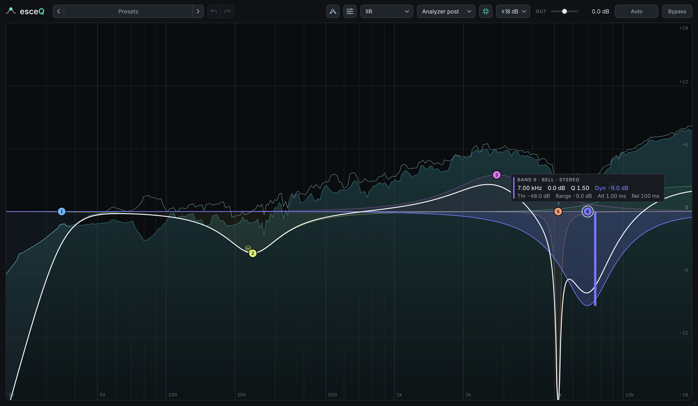
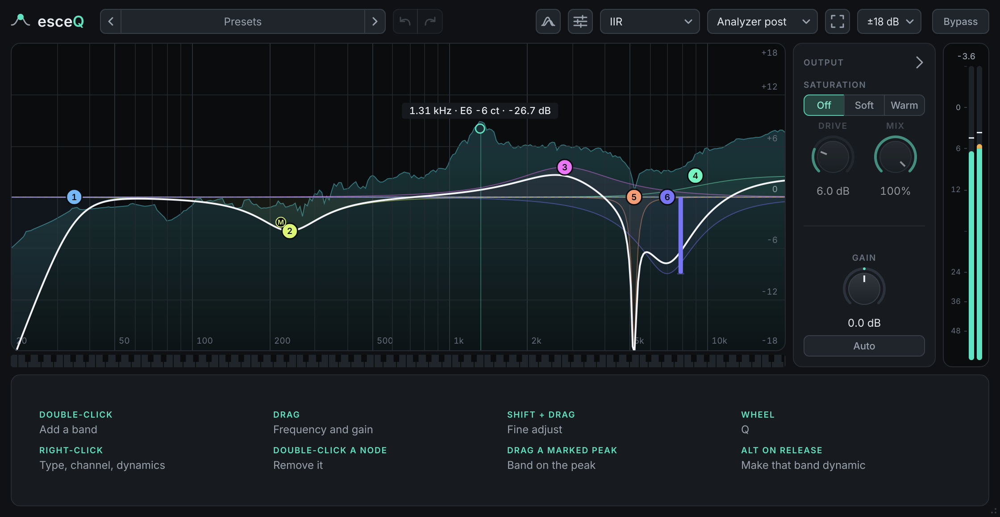
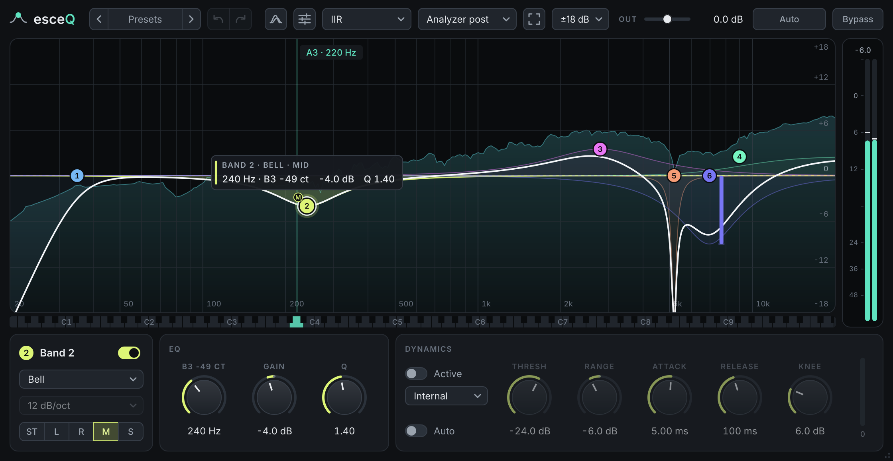
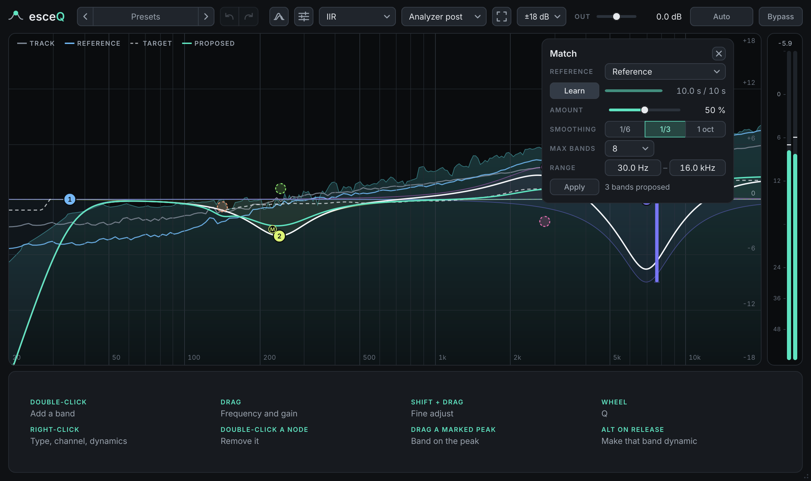

# Interfaz

Cómo está hecha la interfaz de esceQ y qué reglas sigue. Las decisiones y sus motivos están en la [ADR 0008](decisiones/0008-sistema-visual.md); la estructura de módulos, en [arquitectura.md](arquitectura.md).


## Capas

| Capa | Dónde | Qué hace | Tests |
|---|---|---|---|
| Lógica | `ui/logic/` (C++20 puro, sin JUCE) | De gestos a valores, escalas, disposición de la ventana, geometría de la curva | `tests/ui/` |
| Tema | `ui/src/Theme.h` | Colores, tipografía, espaciado, radios y grosores | — |
| Dibujo | `ui/src/Draw.h` | Funciones sin estado que pintan cada pieza en un estado dado | Galería de capturas |
| Componentes | `ui/src/Controls.h`, `BandPanel`, `CurveView`, `OutputMeter`, `EqEditor` | Reciben el ratón y el teclado, deciden el estado, llaman a la lógica y al dibujo | Capturas y `pluginval` |
| Aspecto de JUCE | `ui/src/EsceqLookAndFeel.h` | Viste desplegables, menús, campos de texto y botones de texto | Capturas |

Regla: **si algo se puede calcular sin ventana, va en `ui/logic` con su test.** `ui/src` solo pinta y traduce gestos.

## Sistema de diseño

Todo sale de `ui/src/Theme.h`. Ningún componente escribe un color o una medida de estilo a mano.

### Color

| Token | Valor | Uso |
|---|---|---|
| `window` | `#0F1114` | Fondo de la ventana |
| `plot` | `#0A0C0E` | Fondo de la curva y de los medidores |
| `card` | `#171A1F` | Tarjetas del panel, menús, etiqueta flotante |
| `control` / `controlHover` / `controlDown` | `#20252C` / `#2A313A` / `#333B46` | Cuerpo de los controles: reposo, ratón encima, pulsado |
| `track` | `#2B323B` | Recorrido vacío de arcos, barras e interruptores |
| `line` / `lineStrong` | `#262B32` / `#373E48` | Bordes y rejilla |
| `text` / `textMuted` / `textDim` | `#E7EAEE` / `#9AA3AE` / `#67707C` | Valores, texto secundario, etiquetas y escalas |
| `accent` | `#5FE3C0` | Color propio de esceQ: controles globales, foco de teclado, marca |
| `curve` | `#F3F5F8` | Curva total |
| `analyzerPost` / `analyzerPre` | `#3F8F96` / `#7B8592` | Analizador |
| `warning` / `danger` | `#F0B057` / `#FF5D62` | Bypass y avisos; recorte |

Cada banda tiene su color (`theme::band(i)`: tonos repartidos por la proporción áurea) y **tiñe sus propios controles**: el nodo, su curva, y los potenciómetros e interruptores del panel. Lo global (salida, tamaño de ventana, foco) usa el acento.

### Tipografía

Inter (SIL OFL 1.1), embebida en el binario: Regular, Medium y SemiBold. Los archivos y su licencia están en `ui/assets/fonts/`.

| Token | Tamaño | Uso |
|---|---|---|
| `caption` | 9,5 px, SemiBold, mayúsculas con espaciado | Etiquetas de los potenciómetros, títulos de grupo, escalas |
| `small` | 11 px | Texto de apoyo, segmentos |
| `body` | 12 px | Controles y valores |
| `title` | 13 px, SemiBold | Título de la banda |
| `logo` | 17 px, SemiBold | Marca |

Los valores numéricos usan cifras tabulares (`tnum`): todas las cifras miden lo mismo y el texto no baila al mover un control.

### Espaciado, radios y grosores

- **Espaciado:** rejilla de 4 px (`space::x1` = 4, `x2` = 8, `x3` = 12, `x4` = 16, `x6` = 24). Separación entre tarjetas, 8; relleno de las tarjetas, 12.
- **Radios:** 3 (marcas y medidores), 6 (controles), 10 (tarjetas y la curva).
- **Grosores:** 1 (bordes y rejilla), 1,5 (curvas de banda, anillo de foco), 2 (curva total, indicador del potenciómetro), 3 (arco de valor).

## Controles


A la derecha de la imagen, un menú: los menús, los diálogos y los campos de texto son de JUCE, pintados por `EsceqLookAndFeel` con los mismos colores y la misma letra. Como los menús y los diálogos son ventanas aparte y no heredan el aspecto del editor, quien los abre se lo da (`setLookAndFeel`) y los cierra si el editor desaparece.


Cada control tiene seis estados: reposo, ratón encima, arrastre, foco de teclado, sin efecto (editable, pero el parámetro no influye ahora: por ejemplo, la dinámica apagada) y desactivado (el parámetro no existe para ese tipo de filtro).

### Potenciómetro y barra (`ParamControl`)

| Gesto | Efecto |
|---|---|
| Arrastrar (arriba o a la derecha suben) | Cambia el valor: 200 px recorren todo el rango |
| Mayús mientras se arrastra | Ajuste fino: diez veces más lento |
| Rueda | Cambia el valor en su escala (logarítmica en frecuencia, Q y tiempos); con Mayús, fino |
| Doble clic, o Ctrl/Cmd + clic | Vuelve al valor por defecto |
| Clic en el valor | Lo abre para escribirlo: acepta "1.2k", "350 Hz", "-3", "1.5 s". Intro confirma, Esc cancela |
| Flechas | Un 1 % del rango; con Mayús, un 0,1 %. Re Pág / Av Pág, un 10 % |
| Intro | Abre el valor para escribirlo |
| Supr o Retroceso | Valor por defecto |

El arco de valor sale **del centro** en los parámetros bipolares (ganancia, rango, salida), con un punto que marca el cero, y **del mínimo** en el resto. La lógica está en `esceq/ui/control_logic.h`; el texto se interpreta con `core::parseValue`, el mismo que usa el host.

### Interruptor, selector y desplegable

- `ToggleSwitch`: interruptor (On, Dynamic) o botón que se queda encendido (Auto, Bypass). Espacio o Intro lo cambian.
- `Segmented`: una opción entre unas pocas, todas a la vista (canal de la banda).
- `Dropdown`: desplegable (tipo, pendiente, fuente del detector, analizador, rango). La rueda cambia de opción.

## Ventana

Las zonas y la posición de cada control las calcula `esceq/ui/layout.h`:

```
┌──────────────────────────────────────────────────────────────────────┐
│ marca  presets  deshacer  comparar  opciones  fase  analizador  ampliar  rango  salida  Auto  bypass │  48 px
├──────────────────────────────────────────────────────────┬───────────┤
│                                                          │           │
│                         curva                            │  medidor  │
│                                                          │  52 px    │
│ (teclado de notas, 14 px, si está visible)               │           │
├──────────────┬─────────────────┬─────────────────────────┴───────────┤
│ banda        │ EQ              │ dinámica                            │ 168 px
└──────────────┴─────────────────┴─────────────────────────────────────┘
```

- **Vista ampliada:** sin panel ni medidor, la curva (con el teclado de notas, si se ve) ocupa la ventana menos la barra superior, con el mismo margen de 12 px a los lados y por abajo (ver más abajo).
- **Tamaños:** S (1120 × 580), M (1180 × 700, por defecto) y L (1480 × 860), además del redimensionado libre entre 1120 × 540 y 2400 × 1400. El ancho mínimo es el que necesita la barra superior entera con el navegador de presets en su mínimo ([ADR 0012](decisiones/0012-modos-de-fase.md), [ADR 0014](decisiones/0014-estado-v3-algoritmo-de-filtro.md) y [ADR 0015](decisiones/0015-compensacion-automatica-de-ganancia.md)): en 1120 px el navegador tiene exactamente 140. Los tamaños predefinidos se eligen en el menú de opciones.
- **Sin textos cortados:** los tests de `tests/ui/layout_test.cpp` recorren los tamaños de ventana y comprueban que ninguna zona ni control se solapa, y que cada celda de potenciómetro tiene ancho para su etiqueta y su valor.
- **Escalado:** todo es vectorial y se dibuja en píxeles lógicos; el factor de escala (100, 125, 150, 200 %) lo aplican JUCE y el host. Las líneas de 1 px se alinean a píxeles enteros.

### Barra superior

De izquierda a derecha: la marca; el navegador de presets (anterior, nombre, siguiente; el nombre abre el menú con los de fábrica, los de usuario, guardar, borrar (pide confirmación), valores por defecto y abrir la carpeta; un punto del color de acento indica que el preset se ha modificado); deshacer y rehacer; **comparar** con otras instancias (ver más abajo); **opciones** (ver más abajo); **modo de fase** (IIR, Linear Low, Linear Medium, Linear High; su ayuda dice la latencia del modo que suena, ver [fase-lineal.md](dsp/fase-lineal.md)); modo del analizador; **vista ampliada** (ver más abajo); rango de la curva; ganancia de salida; **compensación automática de ganancia** (ver más abajo) y bypass. El navegador de presets se queda con el ancho que sobra, entre 140 y 320 px. Para que cupiera el botón de la vista ampliada sin ensanchar la ventana mínima, el rango pasó de 92 a 72 px ("±30 dB" mide 34 px), el bypass de 76 a 64 y la separación tras la marca de 16 a 12 ([ADR 0018](decisiones/0018-analizador-ampliado.md)).

### Opciones: precisión en agudos, tamaño de la ventana, escala de notas y analizador

El botón con tres deslizadores, entre Compare y el modo de fase, abre el menú de opciones de la instancia. Tiene cuatro secciones. La primera, **HF accuracy**, elige el algoritmo de filtro de todas las bandas ([ADR 0013](decisiones/0013-correccion-en-agudos.md) y [ADR 0014](decisiones/0014-estado-v3-algoritmo-de-filtro.md)):

- **Classic (as in esceQ 0.1):** el de la 0.1. Cerca de Nyquist estrecha campanas y shelves y hunde los cortes de agudos.
- **Matched (analog-accurate highs):** magnitud ajustada a la del filtro analógico, también cerca de Nyquist.

Está marcado el que suena, y la ayuda del botón lo dice ("Options · HF accuracy: Matched"). Una instancia nueva empieza en Matched; un proyecto guardado antes de la versión 3 del estado abre en Classic y suena igual que entonces. Se guarda con el proyecto, cambiarlo se puede deshacer, y los presets no lo cambian. La curva se dibuja con el algoritmo elegido.

La segunda, **Window size**, cambia la ventana a uno de los tamaños predefinidos: *Small (1120 × 580)*, *Medium (1180 × 700)* o *Large (1480 × 860)*, con el actual marcado si la ventana lo tiene exactamente. Estaba en la barra (S, M, L) y pasó aquí para dejar sitio al botón Auto ([ADR 0015](decisiones/0015-compensacion-automatica-de-ganancia.md)).

La tercera, **Notes**, es la escala de notas ([ADR 0017](decisiones/0017-escala-de-notas.md)): *Piano keyboard*, marcada si se ve el teclado bajo la curva, y el submenú *Tuning: A4 = 440.0 Hz*, con las afinaciones habituales (415, 432, 440, 442, 443 y 444 Hz) y *Other...*, que abre un diálogo para escribir cualquiera de 400 a 480 Hz en pasos de 0,1. Las dos cosas se guardan con el proyecto (`ui.notes`, `ui.a4`), no con los presets, y no se deshacen: son preferencias de la interfaz.

La cuarta, **Analyzer**, son los ajustes del analizador ([ADR 0018](decisiones/0018-analizador-ampliado.md)), cada uno con el actual marcado y en el título de su submenú: *Resolution* (FFT de 4096, 8192 o 16384 puntos), *Fall* (*Slow* 1 s, *Medium* 0,35 s, *Fast* 0,12 s), *Tilt* (0, 3, 4,5 o 6 dB/oct), y los interruptores *Peak hold* y *Freeze*. Los cuatro primeros se guardan con el proyecto (`ui.analyzer_fft`, `ui.analyzer_fall`, `ui.analyzer_tilt`, `ui.analyzer_peaks`), solo si no son los de por defecto, que son los del analizador de siempre; *Freeze* no se guarda. Nada de esto se deshace.

Los textos y la correspondencia entre entradas y acciones están en `ui/logic` (`options_menu.h`), con tests.

### Compensación automática de ganancia

El botón **Auto**, entre la ganancia de salida y el bypass, enciende y apaga la compensación (`auto_gain`, [ADR 0015](decisiones/0015-compensacion-automatica-de-ganancia.md)). Encendido se queda iluminado con el color de acento y dice la compensación que aplica, con una cifra decimal ("Auto -2.3 dB"); apagado dice "Auto". El valor lo calcula la interfaz con la misma función y los mismos ajustes que el procesador (`dsp::autoGainDb`), solo cuando cambian, así que es el que suena aunque el host no esté procesando audio. Mide 92 px: cabe "Auto +12.0 dB". Los textos del botón y de su ayuda están en `ui/logic` (`control_logic.h`).

### Vista ampliada

El botón de las cuatro esquinas, a la derecha del selector del analizador, o la tecla F con el foco en la curva, ocultan el panel de la banda y el medidor de salida: la curva y el analizador ocupan la ventana menos la barra superior (`editorLayout(..., expanded)`; lo comprueba `tests/ui/layout_test.cpp` en los tres tamaños, en el mínimo y en un barrido). Encendido, el botón se ilumina con el color de acento y sus esquinas apuntan hacia dentro. Esc (con el foco en cualquier parte del editor) o el mismo botón vuelven, y la disposición es idéntica a la de antes. Si el teclado de notas se ve, sigue bajo la curva.

Las bandas se editan igual en la curva. Como no se ve el panel, la etiqueta flotante dice además el canal (también "Stereo") y, en los tipos con dinámica, una segunda línea con ella: "Thr -48.0 dB  Range -9.0 dB  Att 1.00 ms  Rel 100 ms", "Auto times" en lugar de los tiempos si son automáticos, "Sidechain" si el detector escucha la entrada externa, o "Dynamics off" (`nodeReadout(..., detailed)`). Solo aparece al señalar o arrastrar un nodo: fija sobre la banda seleccionada taparía los nodos de alrededor.

La vista ampliada no se guarda: un proyecto abre siempre en la vista normal.



### Panel de banda

Tres tarjetas: **banda** (color y número, activación, tipo, pendiente y canal), **EQ** (frecuencia, ganancia y Q) y **dinámica** (activación, fuente del detector con su aviso debajo, el interruptor *Auto* de los tiempos automáticos, umbral, rango, ataque, relajación, rodilla y un medidor de la ganancia dinámica). Los controles que no influyen con el tipo de filtro actual se desactivan; los de la dinámica apagada se atenúan pero se pueden editar. Con *Auto* encendido, el ataque y la relajación se atenúan y dicen "Auto" (también al lector de pantalla): conservan su valor, se pueden editar y vuelven a mandar al apagarlo. La ayuda del interruptor dice los tiempos que corresponden a la frecuencia de la banda ("attack 2.00 ms, release 20.0 ms (200 ms after long notes)", `autoTimingTooltip`; [ADR 0016](decisiones/0016-tiempos-automaticos-en-la-dinamica.md)).

Con el teclado de notas visible, la etiqueta del potenciómetro de frecuencia dice la nota de la banda en lugar de "FREQ" ("A3 +0 CT"): junto al valor no cabe en los tamaños S y M. En el campo de frecuencia se puede escribir una nota ("A3", "C#2", "Eb4", con `#`/`♯` o `b`/`♭`), que suena a su frecuencia con la afinación elegida.

Sin banda seleccionada, el panel muestra los gestos de la curva, en dos filas de cuatro (también los de las bandas desde el espectro):


### Curva

- **Nodos:** reposo; ratón encima (halo y curva resaltada); seleccionado (anillo blanco); arrastre (halo mayor). Con el bypass puesto, se atenúan. El nodo activo se dibuja siempre encima.
- **Etiqueta flotante:** al señalar o arrastrar un nodo, muestra la banda, su tipo, y frecuencia, ganancia y Q; en las bandas dinámicas, también la ganancia dinámica del momento. Se coloca sobre el nodo, o debajo si arriba no cabe, y nunca se sale de la curva (`floatingLabelRect`).
- **Canal:** una insignia con la letra (L, R, M, S) en las bandas que no son estéreo.
- **Medidor de dinámica:** junto al nodo, una guía hasta el límite del rango y una barra con la ganancia que se aplica ahora, en el mismo eje de dB que la curva. Sirve igual para reducción (hacia abajo) y para realce (hacia arriba).
- **Escala de notas:** con el teclado visible, la etiqueta flotante añade a la frecuencia la nota más cercana y su desviación ("220 Hz · A3 +0 ct"). Con Alt (Option en macOS) al arrastrar un nodo, la frecuencia salta a la nota temperada más cercana a donde estaría sin ajustar, así que el nodo no se queda pegado; vale con el teclado oculto también.
- **Igualación:** con el panel Match abierto, los espectros aprendidos, el objetivo, la propuesta y sus nodos en fantasma (ver más abajo).
- **Analizador:** el espectro post relleno y, en pre + post, el pre como línea. Con *Peak hold*, una línea fina más clara con el máximo de cada punto del espectro post (`SpectrumPeakHold`, en `meter_logic.h`); un clic en la escala de dB (la columna de 40 px de la derecha, `onGainScale`) la borra, y cambiar la resolución o la inclinación también. Con *Freeze*, el espectro se queda quieto y la curva dice "Analyzer frozen" arriba a la izquierda; el audio sigue entrando en el historial, así que al descongelar el espectro es el de ese momento.
- **Bandas desde el espectro:** con el analizador encendido y el ratón en un hueco, se marca el pico del espectro más cercano a menos de 1/6 de octava: un círculo de color de acento en su nivel, una línea hasta abajo y una etiqueta con su frecuencia, su nota y su nivel sin la inclinación ("2.40 kHz · D7 +39 ct · -31.0 dB"), y el cursor pasa a ser la flecha vertical. Arrastrar desde ahí crea una campana en el pico, con el Q de su ancho a −3 dB, cuya ganancia sigue al arrastre vertical; al soltar queda seleccionada, y con Alt, dinámica (umbral 3 dB bajo el pico, la ganancia arrastrada como rango). Un clic sin arrastre solo deselecciona. Todo el gesto es una acción de deshacer. Si las 24 bandas están en uso no se marca nada y "No free bands" sale junto al ratón. Los picos se buscan en un promedio de 1 s del espectro post (el pre en pre + post), no en lo que se pinta, que en el ruido tiene picos de azar; congelado, también funciona. La lógica está en `esceq/ui/spectrum_peaks.h`; el algoritmo, en [dsp/picos.md](dsp/picos.md); las decisiones, en la [ADR 0019](decisiones/0019-bandas-desde-el-espectro.md).
- **Fuera de rango:** si la ganancia de una banda no cabe en el rango visible, el nodo se queda junto al borde con una flecha que indica hacia dónde sigue.




### Teclado de notas

Una franja de 14 px bajo la curva, con su misma x y su mismo ancho; la curva cede 18 px de alto y lo demás no se mueve (sin el teclado, la disposición es la de antes, píxel a píxel: lo comprueba `tests/ui/layout_test.cpp`). Las teclas siguen el eje logarítmico, así que cada semitono mide lo mismo: las negras ocupan su semitono y el 60 % del alto; las blancas, además, la mitad de cada negra vecina, por debajo. Van de E0 (20,6 Hz) a D#10 (19,9 kHz) con A4 = 440 Hz, y cada do lleva su octava donde cabe (de C1 a C9; C10, junto al borde, en ventanas anchas como L). Al pasar el ratón, la tecla se ilumina con el color de acento y la curva dibuja su frecuencia como una línea vertical con su nombre ("A3 · 220 Hz"). Las teclas y la tecla bajo el ratón se calculan en `esceq/ui/notes.h`; `PianoKeyboard` solo pinta, y solo se repinta al cambiar la tecla señalada, la afinación o el tamaño.



### Comparar con otras pistas

El botón con dos curvas que se cruzan, a la izquierda del analizador, abre el menú **Compare with**: las demás instancias de esceQ del proyecto, con el nombre y el color de su pista (o "esceQ 2", "esceQ 3"... si el host no los da), marcadas como "(silent)" si no les llega audio. Se pueden elegir varias, todas ("Show all") o ninguna ("Hide all"), y activar o no **Highlight collisions**. Con alguna elegida, el botón se enciende y muestra cuántas.

- Cada instancia elegida se dibuja como una línea con su color, en la escala del analizador. Sin señal, se atenúa y se apaga en unos segundos.
- Donde otra pista tapa a esta, un velo rojo (`colour::danger`) por columnas, más intenso en una franja en el borde inferior; su intensidad es la severidad de la colisión.
- Hasta cuatro etiquetas arriba con la pista y la frecuencia del centro de cada zona ("Bass · 113 Hz"), de la más importante a la menos; si dos se solaparían, se queda la importante (`placeLabels`).

La selección no se guarda con el proyecto (sobrevive a cerrar y abrir la ventana). Solo se ven las instancias del mismo proceso y formato. La lógica está en `esceq/ui/session_overlay.h`; el algoritmo, en [dsp/colisiones.md](dsp/colisiones.md); las decisiones, en la [ADR 0011](decisiones/0011-espectros-compartidos.md).


### Igualar a una referencia: el panel Match

En el menú **Compare with**, debajo de las instancias, *Match to reference…* abre el panel **Match** ([ADR 0023](decisiones/0023-igualar-a-una-referencia.md), PLAN.md 5.6): una tarjeta de 280 × 240 px sobre la esquina superior derecha de la curva, a la izquierda de su escala de dB, también en la vista ampliada (`matchPanelLayout`; `tests/ui/layout_test.cpp` comprueba que cabe en la curva en todos los tamaños, con y sin teclado de notas y en la vista ampliada, sin tapar la barra ni solapar sus controles). Las filas están a 4 px para tapar lo menos posible: aun así, en los tamaños S y M la tarjeta cubre la zona de agudos por encima de unos 0 dB, donde suelen caer los nodos de los shelves de agudos. Se cierra con su botón × o con Esc (con el foco en el panel; abrirlo le da el foco). Cerrarlo, o cerrar la ventana, para el aprendizaje (Stop); lo aprendido y los ajustes siguen en el procesador mientras el plugin está abierto, y no se guardan con el proyecto.

| Fila | Control | Qué hace |
|---|---|---|
| *Reference* | Desplegable | Las otras instancias, con su nombre y " (silent)" si no les llega audio, y *Sidechain*, desactivado con " (not connected)" si el host no lo conecta. Sin nada elegido, la primera instancia con señal. Cambiarla borra lo aprendido |
| *Learn* / *Stop* | Botón, encendido mientras aprende | Empieza desde cero, o para conservando lo aprendido. A su derecha, una barra y los segundos útiles ("3.2 s / 10 s"), que se llena con los 10 s que pide *Apply*. Sin referencia posible está desactivado ("No reference") |
| *Amount* | Barra | De 0 a 100 % (50). Se escribe "75", "75 %" |
| *Smoothing* | Selector | 1/6, 1/3 (por defecto) o 1 octava |
| *Max bands* | Desplegable | De 1 a las bandas libres (8, o las libres si son menos) |
| *Range* | Dos campos | Frecuencia mínima y máxima (30 Hz y 16 kHz), de 20 Hz a 20 kHz: se arrastran o se escriben como el campo de frecuencia, también una nota ("A1"). El que se edita se queda donde se escribe y empuja al otro si el rango baja de 1/3 de octava (junto a 20 Hz o 20 kHz, cede lo que falte) |
| *Apply* | Botón | Crea las bandas propuestas en las libres, de la de menor número en adelante, en una acción de deshacer, y selecciona la primera. Desactivado, su ayuda dice por qué: "Learn 10 s first", "No free bands", "Fitting…" o "Nothing to match" |

A la derecha de *Apply*, una línea de estado: "Learning…", "Fitting…" mientras se recalcula la propuesta (150 ms después del último cambio de un ajuste o de una banda), "3 bands proposed", o el motivo; y, en ámbar, los avisos de cuando el aprendizaje se para solo ("Reference removed", "Sidechain disconnected").

Los campos del rango son un estilo nuevo de `ParamControl`, `Field` (solo el valor, en una caja; en la galería con sus seis estados), y los ajustes del panel no son parámetros del host: el control guarda su valor (`bindLocal`) y no hay gestos ni deshacer.

**Dibujo.** Con 10 s útiles y el panel abierto, la curva dibuja:

- el espectro medio aprendido de la pista (gris, el color del analizador pre) y el de la referencia (con el color de su pista; el sidechain, gris claro), este desplazado para que los dos coincidan en la mediana de su diferencia en los puntos en que los dos están presentes (`matchSpectraDisplay`): el nivel no se iguala;
- la **curva objetivo**, discontinua, con el nivel libre del ajuste, solo donde cuenta (`matchTargetRuns`: se corta donde una de las dos no tiene contenido);
- la **propuesta**, en el color de acento: la curva total estática que se ve (la de las bandas actuales, sin la dinámica) más las bandas nuevas, columna a columna y con el diseño que sonaría, así que coincide con la curva blanca donde no hay bandas nuevas;
- los nodos de las bandas nuevas **en fantasma**: un anillo discontinuo del color de la banda libre que ocuparía cada una (`matchTargetBands`);
- y una leyenda arriba a la izquierda (*Track*, *Reference*, *Target*, *Proposed*), bajo "Analyzer frozen" si está.

Mientras se recalcula, la propuesta anterior se queda atenuada en lugar de desaparecer. Se aprende igual con el analizador apagado: la curva vacía la cola "pre" siempre y, con el panel abierto, le pasa ese audio al controlador (`MatchController::pushTrack`); la cola del sidechain la lee el editor. Las piezas sin ventana están en `esceq/ui/match.h`, con sus tests.



### Medidor de salida

Pico por canal después del ecualizador y de la ganancia de salida. Sube al instante y baja a 24 dB/s; el pico máximo se retiene 1,2 s. Verde hasta −6 dB, ámbar hasta 0 dBFS, rojo por encima. El número de arriba es el pico retenido; se pone rojo si ha habido recorte y se borra con un clic. Escala y balística en `esceq/ui/meter_logic.h`.

## Coste de pintado

El editor consulta el procesador 30 veces por segundo, pero la curva y el medidor solo se repintan si algo ha cambiado: parámetros, ganancia dinámica, frecuencia de muestreo, espectro (más de 0,05 dB en algún punto) o nivel del medidor. Con el transporte parado, o con el analizador apagado y sin bandas dinámicas, no se repinta nada.

Al repintar, `CurveView` no recalcula lo que no ha cambiado: guarda por banda la magnitud en cada columna, sus trazados y la referencia punteada ya convertida en contorno, y solo los rehace si cambia lo que suena en esa banda (al arrastrar un nodo, solo esa banda; con la dinámica actuando, las dinámicas, pero no su referencia estática). `tan(ω/2)` se calcula una vez por columna para todas las bandas (`dsp::responseTangent`). Lo que se dibuja es idéntico píxel a píxel.

Cuánto cuesta, medido con `esceq_snapshot --bench` (ver [CONTRIBUTING.md](../CONTRIBUTING.md)) con las 24 bandas dinámicas, renderizador por software de JUCE en Linux, mediana por fotograma:

| Ventana | Antes de la caché | Con la caché |
|---|---|---|
| L (1480 × 860), escala 1 | 16–18 ms | 12,5–13,5 ms |
| Máxima (2400 × 1400), escala 2 | 75–81 ms | 67–74 ms |

Con el teclado de notas visible, la misma medida (L, escala 1, dos tandas) da una mediana de 12,6–13,0 ms frente a 12,5–12,6 ms sin él: dentro del ruido, con una curva 18 px más baja. El teclado no se repinta en el arrastre (solo al cambiar la tecla señalada, la afinación o el tamaño), y la línea de la tecla señalada es un rectángulo y una etiqueta.

El marcador de las bandas desde el espectro ([ADR 0019](decisiones/0019-bandas-desde-el-espectro.md)) no cambia nada mientras el ratón no está en la curva: con `--bench` (L, escala 1, dos tandas, mediana), de 9,7 a 10,2 ms antes y de 9,9 a 10,1 ms después, con la misma huella del fotograma fijo. Con el ratón sobre la curva se dibujan un círculo, una línea y una etiqueta, y la búsqueda de picos (5,9 µs) solo se rehace si el espectro ha cambiado; el promedio en el que se buscan cuesta 9,3 µs por fotograma con el analizador en marcha.

La vista ampliada ([ADR 0018](decisiones/0018-analizador-ampliado.md)) no cambia nada de esto: solo da más área a la curva. Medido en otra sesión (otra máquina, más rápida que la de la tabla; dos tandas, mediana): en L, la vista normal cuesta de 9,0 a 10,2 ms antes de existir la ampliada y de 9,9 a 10,3 ms con ella, con la misma huella del fotograma fijo; la ampliada en L (curva de 1456 × 800), de 10,3 a 11,8 ms; y en la ventana máxima a escala 1, la ampliada (2376 × 1340) de 20,6 a 21,3 ms, frente a 17,6–21,3 de la normal. Los picos mantenidos son un trazo más y no se notan.

Lo que queda es casi todo rasterizar los rellenos y los trazos (más del 60 % del tiempo a escala 1, más a escala 2): reducirlo exige dibujar otra cosa. En Windows (Direct2D, el renderizador por defecto de JUCE 9) y en macOS (CoreGraphics) la rasterización la hace el sistema; ahí no se ha medido.

## Accesibilidad

- Todos los controles tienen nombre y rol para los lectores de pantalla; los potenciómetros exponen su rango, su valor y su valor como texto ("1.20 kHz").
- Tabulador recorre la barra superior, la curva, el panel Match (si está abierto) y el panel, de izquierda a derecha. El foco de teclado se marca con un anillo del color de acento (solo cuando se llega con el teclado, no al hacer clic).
- En la curva: izquierda y derecha eligen banda; arriba y abajo cambian su ganancia; Ctrl/Cmd + izquierda y derecha, su frecuencia, de semitono en semitono (con Mayús, en pasos finos); Mayús, ajuste fino; Supr la elimina; F amplía o reduce la vista, y Esc vuelve.
- El teclado de notas no recibe el foco: es una referencia visual, y la nota se lee en la etiqueta y se escribe en el campo de frecuencia.
- Limitación: los nodos no son elementos accesibles individuales.

## Antes y después

Fase 3 (controles por defecto de JUCE):


Fase 4: la captura del principio de esta página.

## Cómo cambiar el aspecto

1. Colores, letra, medidas: `ui/src/Theme.h`.
2. Forma de un control: su función en `ui/src/Draw.cpp`.
3. Posición de algo: `ui/logic/src/layout.cpp`, y ejecutar los tests.
4. Regenerar las capturas (ver [CONTRIBUTING.md](../CONTRIBUTING.md)) y mirarlas en los tres tamaños.
